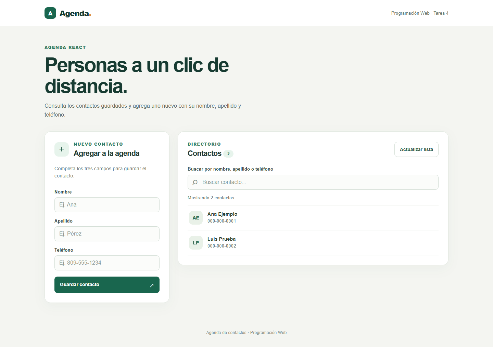
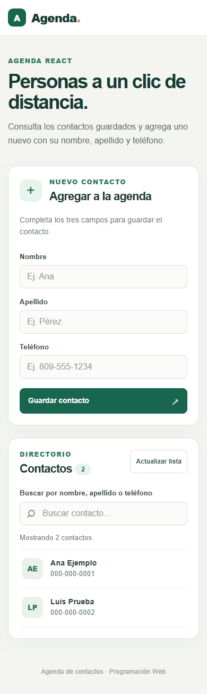

# Agenda React

Tarea 4 de Programación Web. Esta tarea consiste en rehacer la agenda anterior con React, usando un componente para listar contactos y otro para agregarlos, ambos dentro de un componente padre.

## Datos del estudiante

- Nombre: Maxwel Kenen Sael Soriano.
- Matrícula: 2025-1984.
- Institución: Instituto Tecnológico de Las Américas (ITLA).
- Carrera: Desarrollo de Software.
- Asignatura: Programación Web.
- Tarea: 4 — Agenda React.

## Cómo funciona

La agenda está implementada con React, JavaScript y Vite. El componente padre `Agenda` coordina la consulta y el guardado; `FormularioContacto` controla los campos y el envío, y `ListaContactos` muestra los contactos y los controles de búsqueda y actualización.

- Consulta los contactos de `https://www.raydelto.org/agenda.php` y permite buscar por nombre, apellido o teléfono.
- Envía por POST un JSON con `nombre`, `apellido` y `telefono`, quitando espacios al inicio y al final. Los tres campos son obligatorios.
- Después de guardar, vuelve a consultar el listado. Si el guardado funciona y esa consulta falla, el mensaje lo aclara para evitar reenviar el contacto.
- Muestra estados de carga, agenda vacía, búsqueda sin resultados y errores. Durante el guardado se bloquean los campos y el botón para evitar envíos duplicados.
- Conserva el diseño adaptable de la tarea anterior. Los datos se guardan en el servicio compartido, no en el navegador.

El padre pasa los datos y las acciones mediante props. El listado recibe los contactos, la búsqueda y los estados de consulta; el formulario recibe la función `onGuardar` y avisa al padre cuando se envía un contacto. No se manipula el DOM manualmente para construir la interfaz.

Se necesita conexión a Internet para consultar y guardar. Si el servicio no está disponible, la página muestra un error y permite intentar de nuevo con **Actualizar lista**.

## Vista de la aplicación

Estas son capturas reales de la aplicación compilada, ejecutada en Edge con **respuestas simuladas y datos de demostración**. No muestran teléfonos de la agenda compartida. Al abrir la aplicación normalmente, se consulta el servicio real.

**Escritorio**



**Móvil**



## Cómo ejecutarla

Se necesita Node.js y npm. El proyecto se verificó con Node.js 24.19.0 y npm 11.17.0.

Desde la raíz del proyecto:

```sh
npm install
npm run dev
```

Abre la dirección que indique la terminal. Vite suele usar `http://localhost:5173`; si el puerto está ocupado, mostrará otro.

Para revisar el código y generar la compilación:

```sh
npm run lint
npm run build
```

Después de compilar, `npm run preview` permite abrir el resultado localmente. La dirección aparece en la terminal.

## Estructura

```text
AgendaReact/
├── index.html                  Entrada de la aplicación
├── js/
│   ├── main.jsx                Monta React en la página
│   ├── components/
│   │   ├── Agenda.jsx          Componente padre
│   │   ├── FormularioContacto.jsx
│   │   └── ListaContactos.jsx
│   └── services/
│       └── agenda.js           Peticiones al servicio de contactos
├── css/
│   └── styles.css              Diseño y adaptación a móvil
├── img/
│   ├── agenda-escritorio.png    Captura de escritorio
│   └── agenda-movil.png         Captura de móvil
├── README.md                   Descripción e instrucciones
├── package.json               Dependencias y comandos
├── package-lock.json          Versiones de las dependencias
├── vite.config.js             Configuración de Vite
└── .oxlintrc.json              Configuración del análisis de código
```

Las dependencias instaladas y la carpeta `dist/` de compilación se excluyen de Git.

## Comprobaciones

El análisis de código y la compilación terminaron correctamente. Sobre la compilación de producción se comprobaron 11 escenarios en Edge con respuestas simuladas: carga inicial, agenda vacía, búsqueda, consulta fallida y reintento, formato de respuesta inválido, normalización de datos y contenido escapado, campos obligatorios, guardado y bloqueo de duplicados, envío fallido y reintento, guardado con recarga fallida, y diseño adaptable con navegación básica por teclado.

Se revisaron las vistas de escritorio y móvil de 390 px, sin desbordamiento horizontal. En una consulta GET real durante la revisión final, el servicio respondió con HTTP 200 y la aplicación mostró los contactos. Los envíos POST se probaron únicamente con respuestas simuladas; no se insertaron contactos de prueba en la agenda compartida. El resultado del GET corresponde a esa revisión y puede cambiar si el servicio deja de estar disponible.
